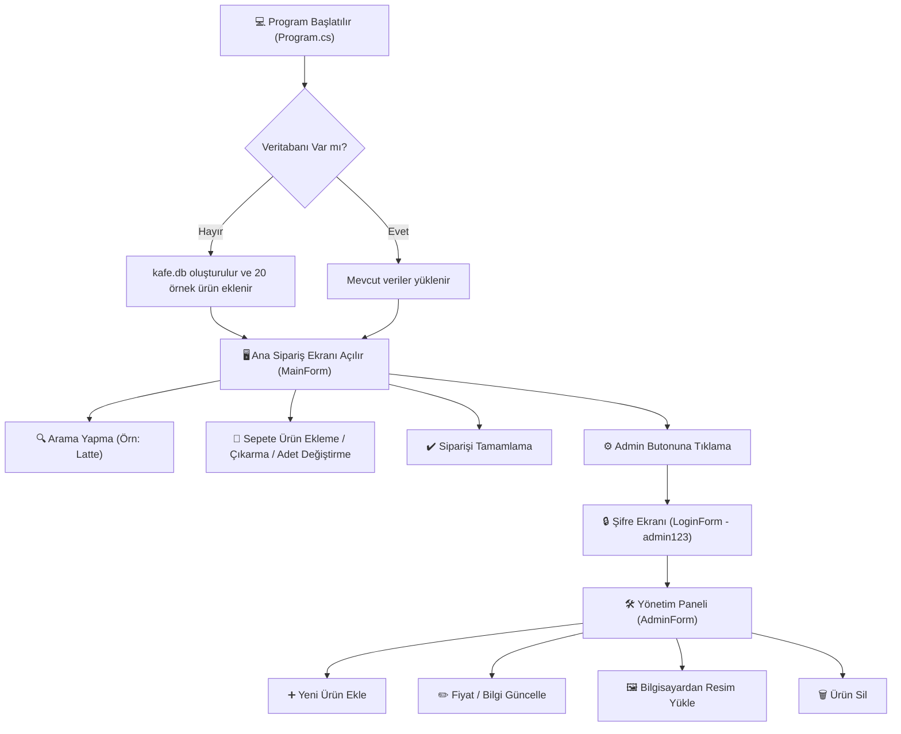

# ☕ Kahve Köşesi – POS & Kafe Yönetim Sistemi

Bu proje; kahve dükkanları, pastaneler ve kafeler için geliştirilmiş, **C# Windows Forms** ve **gömülü SQLite veritabanı** kullanan modern, şık ve kullanımı çok kolay bir masaüstü sipariş ve yönetim (POS) uygulamasıdır.

Hiç yazılım bilmeyen birinin bile sistemi rahatça anlaması için tüm parçaların ne işe yaradığı, hangi işlemin nerede ve nasıl yapıldığı aşağıda adım adım açıklanmıştır.

---

## 🧭 Genel Çalışma Mantığı (Kuşbakışı)



---

## 🏗️ Hangi Parça Ne İşe Yarar? (Dosya Dosya Açıklama)

Projeyi oluşturan her bir dosya, tıpkı bir restorandaki çalışanlar gibi farklı bir görevden sorumludur:

| Klasör / Dosya | Görevi Nedir? | Ne İşe Yarar? (Basitçe) |
|---|---|---|
| **`Program.cs`** | Sistemin Açılış Kapısı | Uygulama ilk açıldığında ilk burası çalışır. Veritabanını kontrol eder, hazır hale getirir ve ana ekranı başlatır. |
| **`Data/DatabaseHelper.cs`** | Veritabanı Ustası | SQL sorgularını yöneten merkezdir. Ürünleri okur, arar, kaydeder, siler ve fiyatları günceller. |
| **`Models/Product.cs`** | Ürünün Kimlik Kartı | Bir ürünün nesi olduğunu tanımlar: ID, İsim, Açıklama, Fiyat, Kategori, Resim Dosyası Yolu ve Aktiflik durumu. |
| **`Models/CartItem.cs`** | Sepetteki Bir Kalem | Sepete atılan bir ürünü ve onun adedini tutar. `Fiyat x Adet = Ara Toplam` hesabını anında yapar. |
| **`Forms/MainForm.cs`** | Müşteri / Kasiyer Ekranı | Ürünlerin 4x2 sayfalı dizildiği, arama yapılan ve sağ tarafta sepetin toplandığı vitrin ekranıdır. |
| **`Forms/LoginForm.cs`** | Güvenlik / Şifre Girişi | Kasiyer ekranından Admin Paneline geçmek isteyenlere şifre (`admin123`) soran güvenlik kapısıdır. |
| **`Forms/AdminForm.cs`** | Patron / Yönetici Paneli | Yeni ürün ekleme, fiyat değiştirme, ürün silme ve bilgisayardan ürün resmi yükleme ekranıdır. |
| **`kafe.db`** | Dijital Defter (Veritabanı) | Tüm ürünlerin, fiyatların ve şifrenin kaydedildiği tek bir dosyadır. |

---

## ⚙️ Hangi İşlem İçin Hangi Teknoloji Kullanılıyor?

### 1. Neden C# ve Windows Forms (.NET 9)?
- **Ne için kullanıldı:** Ekrandaki pencereler, butonlar, resim kutuları, yazı alanları ve renk temaları için.
- **Mantığı:** Masaüstünde fare ile çok hızlı tepki veren, kasma yapmayan, Windows ile %100 uyumlu klasik ve güvenilir bir masaüstü teknolojisidir.

### 2. Neden SQLite (Gömülü Veritabanı)?
- **Ne için kullanıldı:** Ürünleri, fiyatları ve açıklamaları kalıcı olarak saklamak için.
- **Neden MySQL Yerine Seçildi?:**
  - MySQL gibi dışarıdan ekstra bir sunucu (XAMPP, Wamp, MySQL Server vb.) kurmanıza **asla gerek bırakmaz**.
  - Programın çalıştığı klasörün içinde `kafe.db` adında tek bir dosya olarak yaşar.
  - Program açıldığında bu dosya yoksa sıfırdan **kendisi otomatik oluşturur** ve örnek menüyü içine yazar.
  - Programı başka bir bilgisayara taşımak istediğinizde sadece klasörü kopyalamanız yeterlidir; veritabanı da beraberinde taşınır!

### 3. Bellek Akışı ile Resim Yükleme (`MemoryStream`)
- **Ne için kullanıldı:** Ürün resimlerinin görüntülenmesi ve değiştirilmesi için.
- **Mantığı:** Normalde resimler diskten doğrudan açıldığında Windows o dosyayı kilitler ve resmi silmenize ya da değiştirmenize izin vermez. Bu sistemde resim dosyasının baytları hafızaya (RAM) kopyalanıp gösterilir. Böylece diskteki resim hiçbir zaman kilitlenmez, yönetici paneli üzerinden resim kolayca değiştirilebilir.

---

## 📱 Ekranların Çalışma Mantığı (Adım Adım)

### 1. Ana Ekran (Müşteri & Satış Vitrini)
* **4x2 Izgara Düzeni (Sayfada 8 Ürün):**
  - Menüdeki ürünler yan yana 4 tane, alt alta 2 satır olacak şekilde toplam 8'erli sayfalara bölünür.
  - Ürün sayısı 8'i geçerse alt taraftaki **◀ Önceki** ve **Sonraki ▶** butonları aktifleşir.
* **Ürün Kartı:**
  - Her kartta; ürünün kategori etiketi (☕ Kahve, 🎂 Pasta, 🍪 Kurabiye, 🍫 Çikolata), ürün resmi, ürün adı, kısa açıklaması, fiyatı ve **+ EKLE** butonu yer alır.
* **Sağ Üst Arama Kutusu:**
  - Örneğin arama kutusuna `lat` yazdığınız anda sistem harfleri anlık algılar ve yalnızca isminde veya açıklamasında "lat" geçen ürünleri (örn. *Latte*, *White Latte*) ekrana getirir.
  - Arama kutusu silindiğinde tüm liste eski haline döner.
* **Sağ Panel: Sepet ve Toplam Tutar:**
  - Bir ürünün altındaki **+ EKLE** butonuna tıklandığında sağdaki sepete eklenir.
  - Aynı ürüne tekrar tıklanırsa sepette yeni satır açmak yerine o ürünün **adedi artar**.
  - Sepet üzerindeki **`+`** butonu adedi artırır, **`−`** butonu adedi azaltır (adet 1 iken eksiye basılırsa ürün sepetten çıkar).
  - Sağdaki **`✕`** butonu ürünü doğrudan sepetten kaldırır.
  - Her işlemde en alttaki **TOPLAM** fiyat matematiksel olarak anında güncellenir.
  - **Sepeti Temizle** sepeti sıfırlar; **Siparişi Tamamla** ise sipariş dökümünü bir onay kutusunda gösterip satışı tamamlar.

---

### 2. Yönetim (Admin) Paneli
Ana ekranın sağ üst köşesindeki **⚙ Admin** butonuna basılıp şifre (**`admin123`**) girildiğinde açılır.

* **Sol Taraf (Ürün Listesi Tablosu):**
  - Veritabanındaki tüm ürünleri ID, Kategori, Ad, Fiyat ve Durum olarak bir tabloda gösterir.
  - Tablodan bir ürüne tıklandığında sağ taraftaki kutular otomatik olarak o ürünün bilgileriyle dolar.
* **Sağ Taraf (Düzenleme & Ekleme Formu):**
  - **Görsel Seç Butonu:** Bilgisayarınızdan istediğiniz herhangi bir resmi (`.jpg`, `.png` vb.) seçmenizi sağlar. Seçilen resim güvenli bir şekilde projenin `images/` klasörüne kopyalanır.
  - **Fiyat Değiştirme:** Fiyat kutusuna yeni rakamı yazıp **💾 Kaydet** demeniz yeterlidir.
  - **Aktiflik Kutusu:** Bir ürünün stoğu bittiğinde silmek yerine "Aktif" işaretini kaldırırsanız, ürün admin panelinde kalır ama müşteri ekranından gizlenir.
  - **+ Yeni Ürün Butonu:** Tüm kutuları boşaltır ve sıfırdan yeni bir ürün tanımlamanızı sağlar.
  - **🗑️ Sil Butonu:** Seçili ürünü veritabanından tamamen siler.
* Admin panelinde yapılan herhangi bir değişiklik kaydedildiği anda, ana sipariş ekranındaki liste de kendini otomatik olarak günceller.

---

## 🚀 Projeyi Çalıştırma Yöntemleri

### Yöntem 1: Doğrudan Exe ile Çalıştırma (En Hızlı)
Hiçbir kod editörü açmadan, derlenmiş dosyaya çift tıklayarak çalıştırabilirsiniz:
```
C:\kafe\CoffeeShopApp\bin\Debug\net9.0-windows\CoffeeShopApp.exe
```

### Yöntem 2: Visual Studio ile Çalıştırma
1. `C:\kafe\CoffeeShopApp.sln` çözüm dosyasına çift tıklayıp Visual Studio 2022'de açın.
2. Klavyeden **F5** tuşuna basın.

### Yöntem 3: Terminal / Komut Satırı ile Çalıştırma
```powershell
cd C:\kafe
dotnet run --project CoffeeShopApp
```

---

## 🔐 Varsayılan Giriş Bilgileri

- **Admin Paneli Şifresi:** `admin123`
- *(İstenirse admin panelinden veya veritabanındaki `admin_settings` tablosundan şifre kolayca değiştirilebilir).*

---

## 💾 Veritabanı Yedekleme & Sıfırlama
- **Yedek Alma:** `C:\kafe\CoffeeShopApp\bin\Debug\net9.0-windows\kafe.db` dosyasını kopyalayıp bir yere kaydetmeniz tüm veritabanınızı (ürünler, fiyatlar, ayarlar) yedeklemeniz için yeterlidir.
- **Sıfırlama:** Eğer menüyü ilk haline döndürmek isterseniz `kafe.db` dosyasını silmeniz yeterlidir. Program bir sonraki açılışında 20 örnek ürünle birlikte veritabanını otomatik olarak yeniden kuracaktır.
